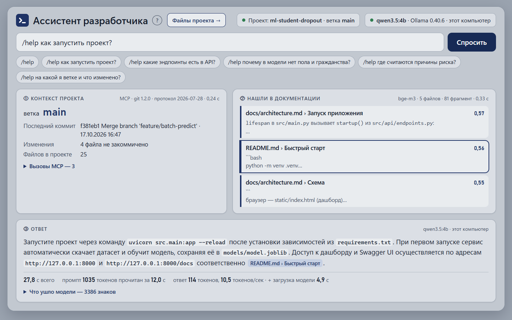
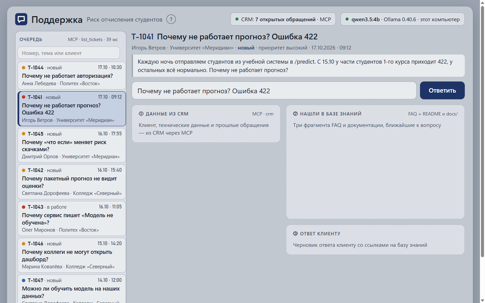
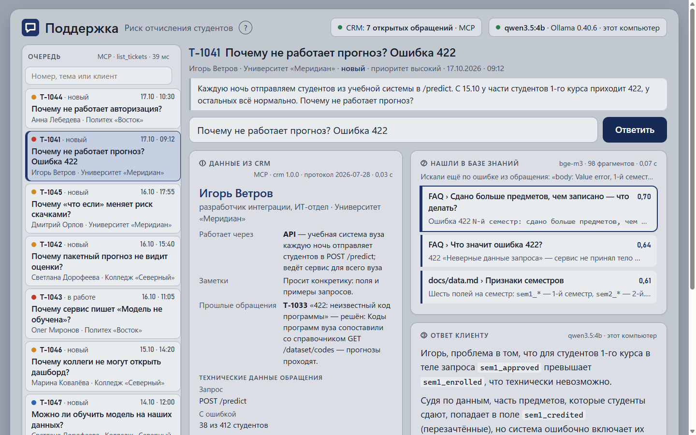
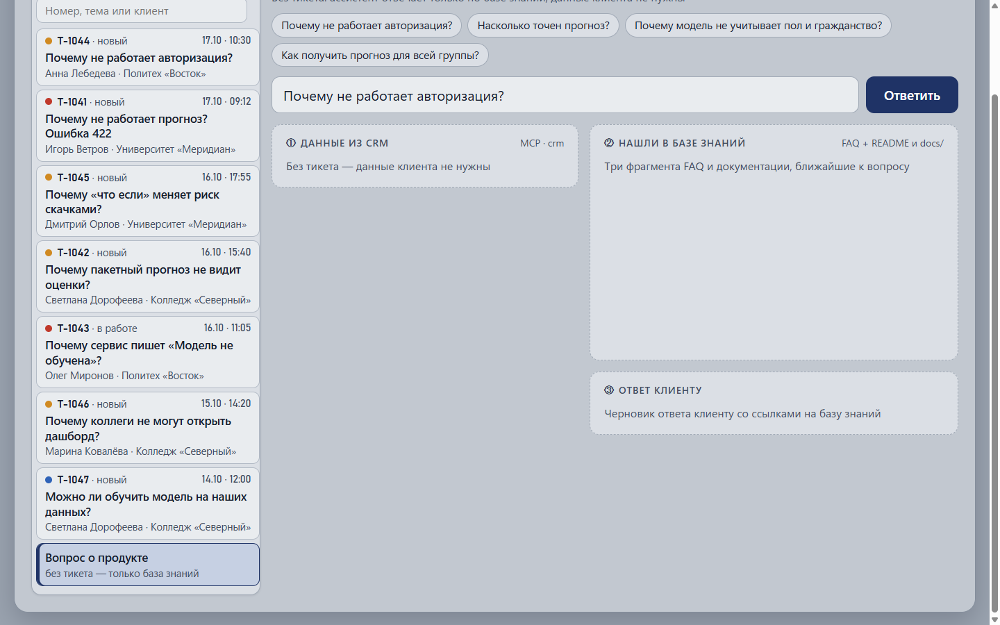
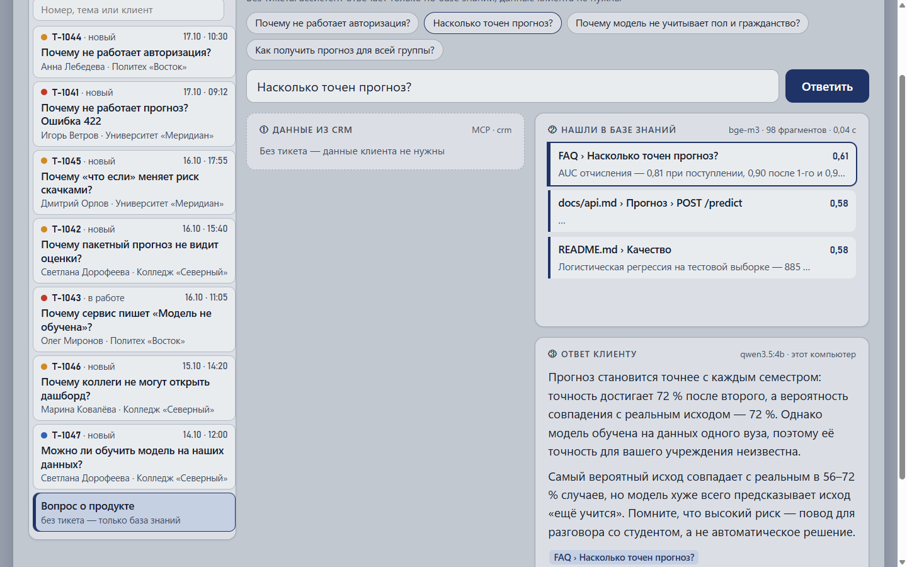
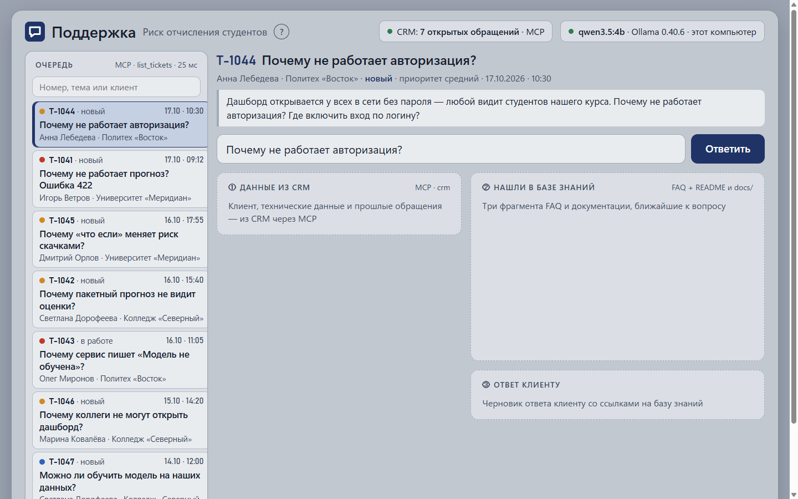
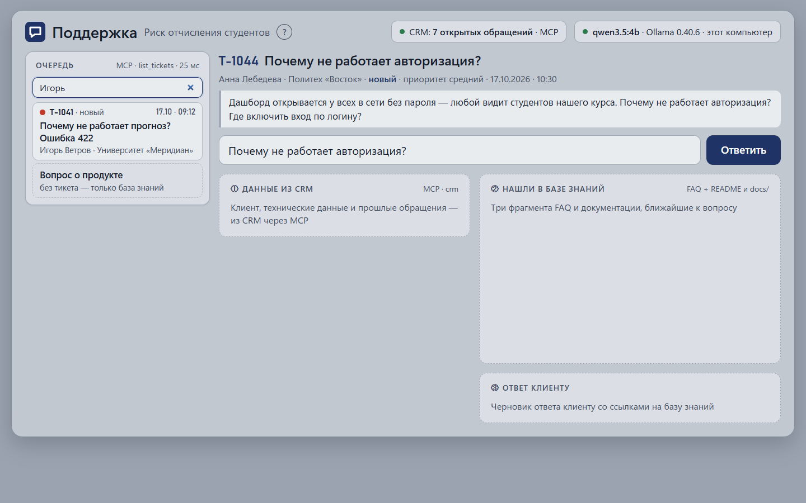
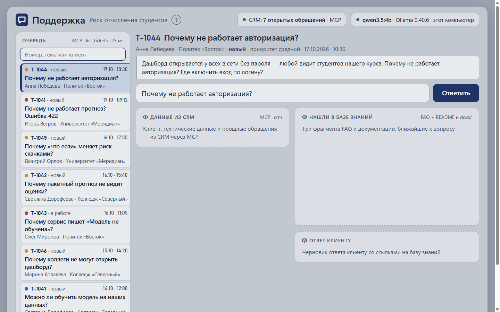
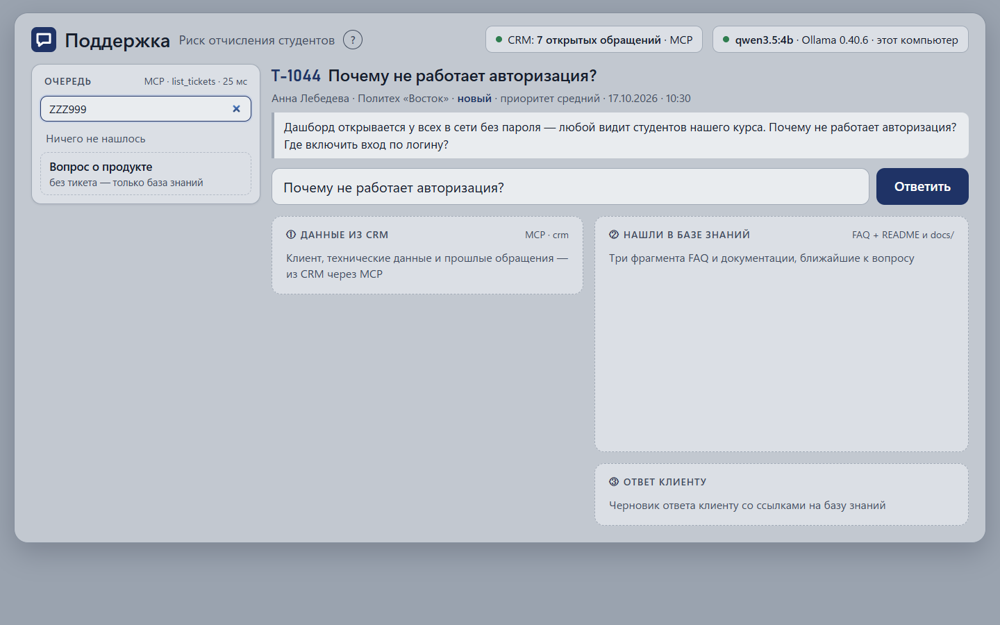

# Отчёт QA — 2026-10-21_16-45, ветка feature-v1

**Итог: ✅ всё прошло** · тесты: 30/30 · smoke: 9/9 сценариев (С1-2, С3-2, С5-5)

## Что изменилось
- `static/support.html` — добавлен поиск по очереди тикетов (поле `#find`, фильтрация по ID/теме/клиенту); проверено: smoke С5.

## Уровень 1 — тесты кода
`.venv/Scripts/python.exe tests/run.py -v` → `Ran 30 tests in 0.001s, OK`; запусков — 1: всё прошло с первого раза.

| Модуль | Файл тестов | Тестов | Итог |
|---|---|---|---|
| rag.py | test_rag.py | 11 | OK |
| assistant.py | test_assistant.py | 10 | OK |
| support.py | test_support.py | 9 | OK |

Изменённые функции в `app/` отсутствуют — правки только в frontend (`static/support.html`).

## Уровень 2 — smoke-сценарии

### С1. /help: вопрос о проекте — ✅
1. ✅ Открыть http://127.0.0.1:8765/ → «ml-student-dropout», заголовок «Ассистент разработчика», модель qwen3.5:4b

   

2. ✅ Ввести «/help как запустить проект?», нажать #sendBtn → ответ со ссылками на документацию

   

### С2. Поддержка: ответ клиенту по обращению — ✅
1. ✅ Открыть http://127.0.0.1:8765/support → «CRM: 7 открытых обращений», очередь с T-…

   

2. ✅ Нажать button.item[data-id="T-1041"] → номер T-1041, тема «Почему не работает прогноз? Ошибка 422»

   

3. ✅ Нажать #sendBtn → CRM данные Игоря Ветрова, база знаний, ответ по имени

   

### С3. Поддержка: вопрос о продукте без тикета — ✅
1. ✅ Нажать button.item.free → «Вопрос о продукте», примеры вопросов

   

2. ✅ Нажать «Насколько точен прогноз?» → ответ по базе знаний без CRM

   

### С5. Поддержка: поиск по очереди тикетов — ✅ (новая фича)
1. ✅ Очередь полная, поле #find пустое

   

2. ✅ Ввести «T-1041» → показаны только T-1041 и «Вопрос о продукте»

   

3. ✅ Ввести «Игорь» → показан тикет Игоря Ветрова

   

4. ✅ Очистить #find → полный список восстановлен

   

5. ✅ Ввести «ZZZ999» → сообщение «Ничего не нашлось»

   

## Что сломалось и где искать
—
