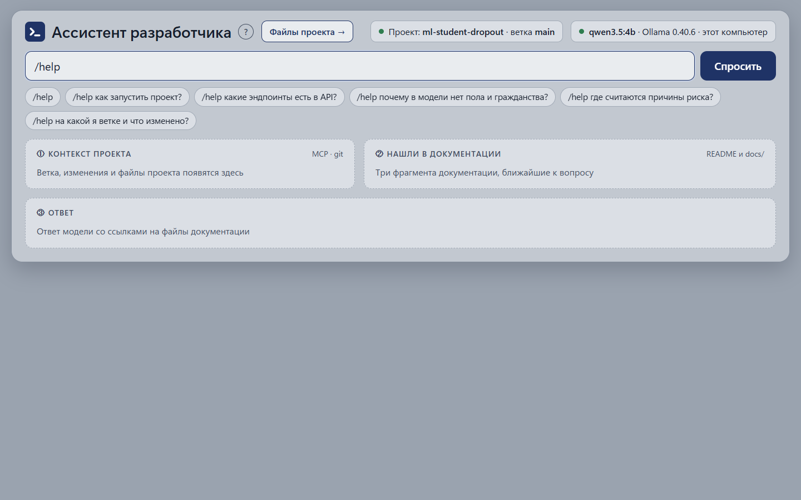
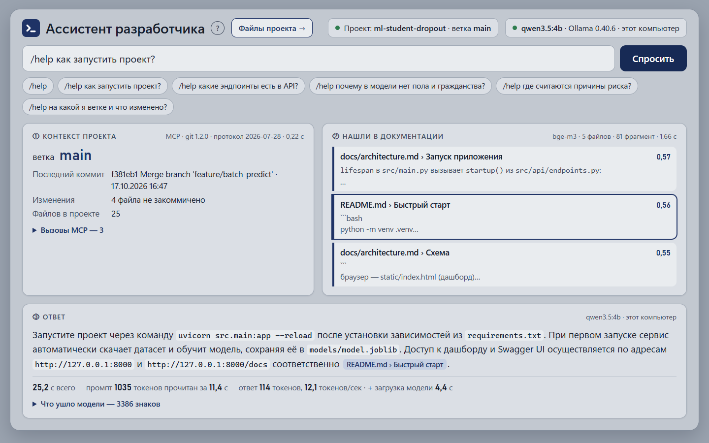
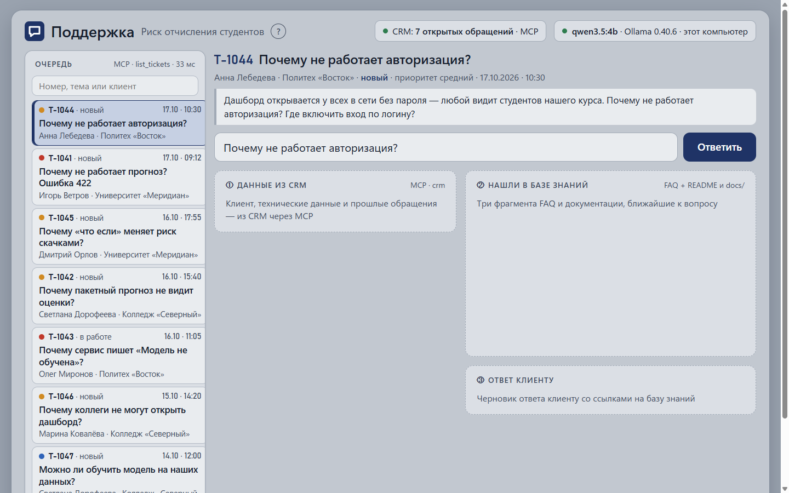
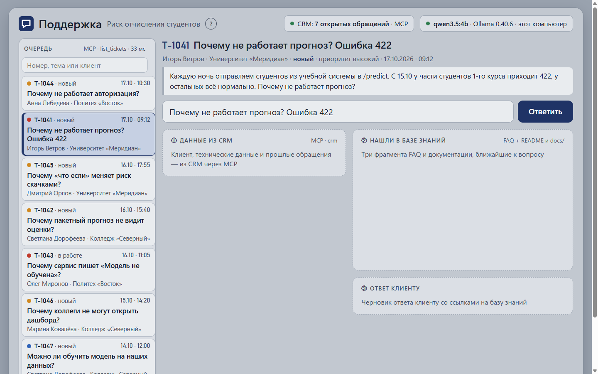
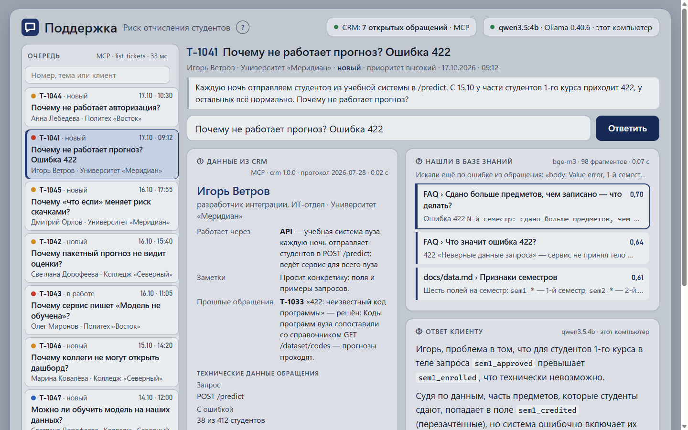
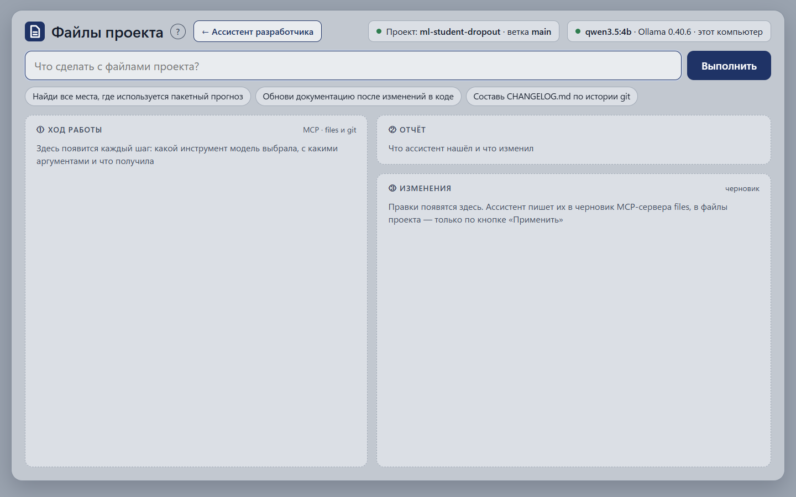
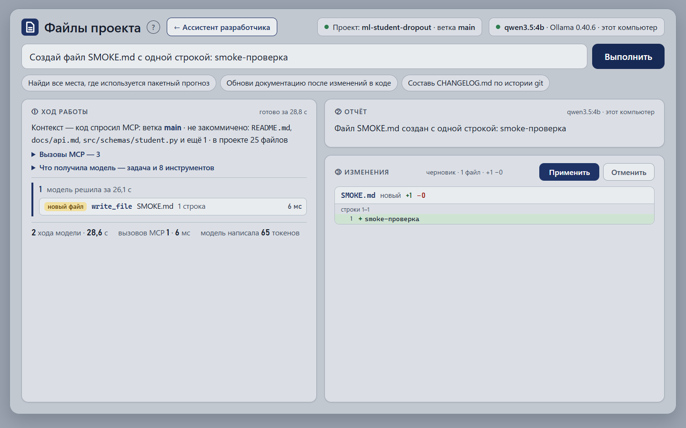
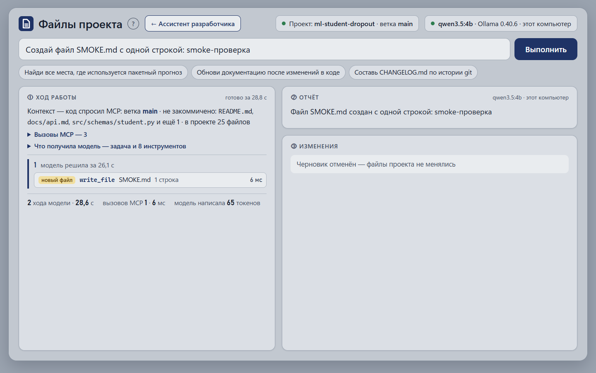
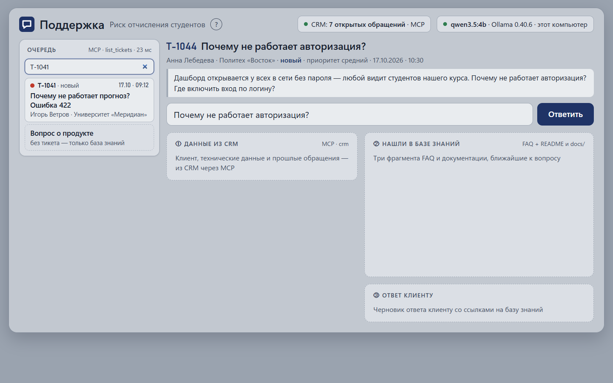
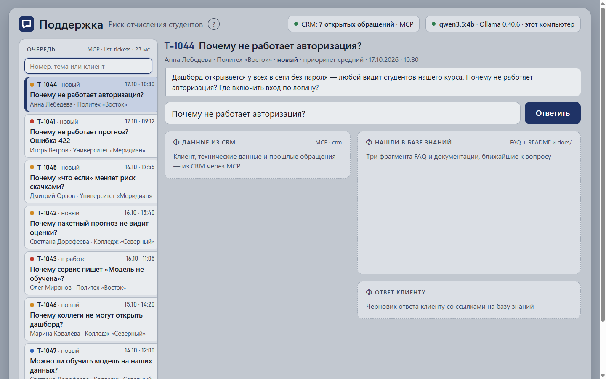

# Отчёт QA — 2026-10-21_17-28, ветка task-day-38

**Итог: ✅ всё прошло** · тесты: — (изменений в коде app/ нет) · smoke: 5/5

## Что изменилось
- `static/support.html` — добавлено поле поиска по очереди (`#find`) с фильтрацией тикетов по номеру, теме, имени клиента и организации; чем проверено: С5.

## Уровень 1 — тесты кода

Изменения только в статике (`static/support.html`). Код `app/` не менялся — тесты писать не нужно.

## Уровень 2 — smoke-сценарии

### С1. /help: вопрос о проекте — ✅
1. ✅ Открыть `/` → заголовок «Ассистент разработчика», проект `ml-student-dropout`, ветка main, модель qwen3.5:4b · Ollama 0.40.6

   

2. ✅ Ввести `/help как запустить проект?`, нажать send → ответ со ссылкой на документацию, карточки MCP и docs

   

### С2. Поддержка: ответ клиенту по обращению — ✅
1. ✅ Открыть `/support` → очередь 7 тикетов, последний «Вопрос о продукте»

   

2. ✅ Нажать T-1041 → карточка тикета: номер, тема про прогноз 422, клиент Игорь Ветров · Университет «Меридиан»

   

3. ✅ Нажать send → ответ ассистента с обращением к Игорю, данные CRM и фрагменты KB

   

### С3. Поддержка: вопрос о продукте без тикета — ✅
1. ✅ Открыть `/support`, нажать free → «Вопрос о продукте», примеры вопросов

   

2. ✅ Нажать пример «Насколько точен прогноз» → ответ по базе знаний без данных клиента

   

### С4. Файлы: задача → черновик → отмена — ✅
1. ✅ Открыть `/files` → поле задачи `#goal`, card «Правки появятся здесь»

   

2. ✅ Ввести задачу, нажать run → черновик с файлом SMOKE.md, статус «готово за 28,8 с»

   

3. ✅ Нажать Отменить → «Черновик отменён — файлы проекта не менялись»

   

### С5. Поддержка: поиск по очереди — ✅ (новая фича)
1. ✅ Открыть `/support` → есть поле `#find` с плейсхолдером «Поиск по очереди»

   

2. ✅ Ввести «T-1041» → в очереди показан только T-1041 (и «Вопрос о продукте»)

   

3. ✅ Ввести «ветров» → остался только тикет Игоря Ветрова

   

4. ✅ Очистить поле → все 7 тикетов + «Вопрос о продукте»

   

## Что сломалось и где искать
—
